<!-- Generated by scripts/build.mjs. Edit scripts/config.mjs and rebuild instead of editing this file. -->

  

  
  
  

  
  

  
  

  
  

Plain-text version

### Priyanshu Yadav

AI Engineer · LLMOps & Evals · Full-Stack Developer · Agent & RAG Systems

I build LLM agents that cite their sources, the evals and tracing that keep them honest, and the full-stack products around them.

**What I build**

- **AI Engineering**: Multi-agent graphs in LangGraph, Hybrid-search RAG, cited answers, Tool calling, MCP, human review, Speech, OCR and vision pipelines
- **LLMOps & Evals**: Eval harnesses, regression suites, OpenTelemetry traces per step, Structured output + validation, Any provider, hosted or local
- **Full-Stack & Desktop**: Next.js, React, TypeScript UIs, Node + FastAPI, Postgres, Redis, Electron, Tauri, Rust, Swift, Docker, CI/CD, cloud deploys

**Tech stack**

- **Agents & LLMs**: LangGraph, LangChain, Claude, OpenAI, Gemini, Groq, MCP, llama.cpp
- **RAG · ML · Vision**: Qdrant, OpenSearch, PyTorch, ONNX, OpenCV, Whisper, OCR, NumPy
- **LLMOps & Evals**: OpenTelemetry, OpenInference, Pydantic, pytest, Celery, Redis, Ruff, uv
- **Web**: TypeScript, React, Next.js, Vite, Tailwind, shadcn/ui, TanStack, Zod
- **Backend & Data**: Python, Node.js, FastAPI, Express, PostgreSQL, MySQL, SQLite, Supabase
- **Desktop & Systems**: Rust, Tauri, Electron, Swift, .NET / C#, PowerShell, Win32, Capacitor
- **Cloud & DevOps**: Docker, Actions, AWS, Vercel, Render, Fly.io, Nginx, Linux

**Featured projects**

- [Claude Profile Switcher](https://github.com/PriyanshuGeTRekT/Claude-Code-Desktop-Switcher): Run several Claude desktop accounts side by side on Windows, macOS and Linux. One click to add or switch, with sign-ins routed to the right account.
- [AgentDeck](https://github.com/PriyanshuGeTRekT/AI-harness-Character-creator): One local control panel for 21 AI coding agents: behavior, permissions, token cost, skills, subagents, MCP servers and hooks. Zero dependencies.
- [RFP Intelligence](https://github.com/PriyanshuGeTRekT/rfp-intelligence): Hybrid search and multi-agent extraction over public bid documents. Every field is cited to a file, page and quote, backed by evals and agent traces.
- [Brightness Tray](https://github.com/PriyanshuGeTRekT/Universal-Monitor-Brightness-control): A ~340 KB Windows tray app that sets the brightness of every display: laptop panels, DDC/CI monitors and a software fallback. 0% idle CPU.
- [Lead Research Agent](https://github.com/PriyanshuGeTRekT/AI-Lead-Generation-Research-Agent-): Supervisor multi-agent pipeline for B2B lead research: multi-source search, LLM scoring and enrichment, then human review before any outreach.
- [namanpuja.com](https://github.com/PriyanshuGeTRekT/frontend-namanpuja): Production booking platform for Vedic pujas: a Next.js storefront, an Express + TypeScript API, an admin console and a CRM that syncs every booking.

**Links**

- [LinkedIn](https://www.linkedin.com/in/priyanshuyadav98/)
- [namanpuja.com](https://www.namanpuja.com/)
- [All repositories](https://github.com/PriyanshuGeTRekT?tab=repositories)

  
   
  This page rebuilds itself every day from <a href="scripts/config.mjs">one config file</a>.

